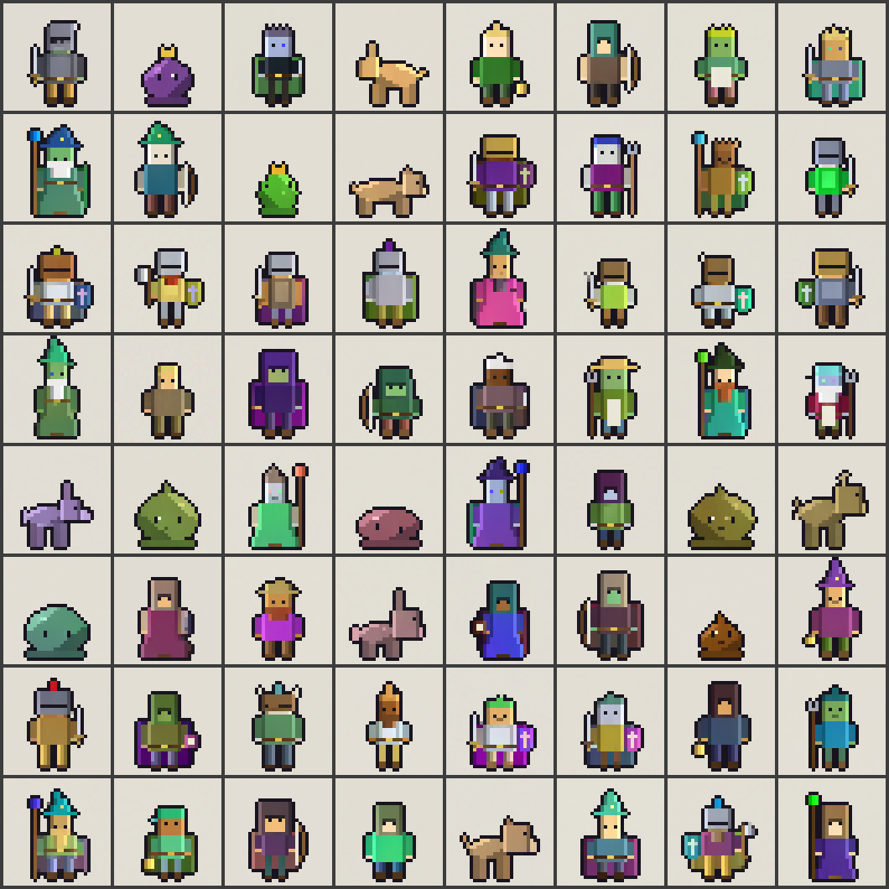
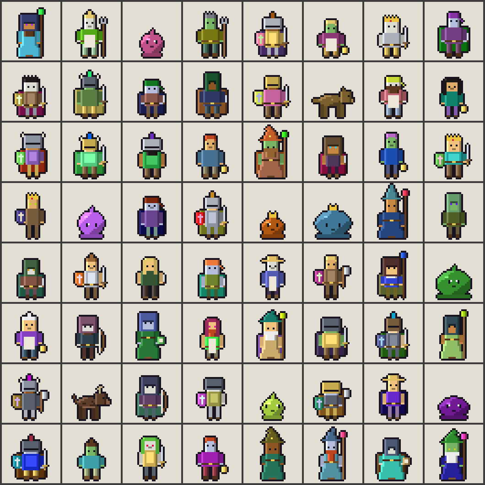
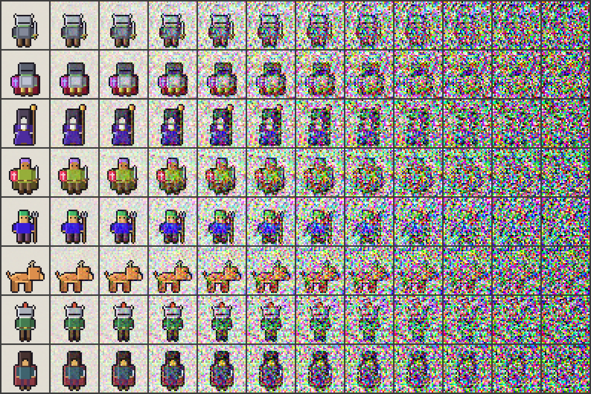
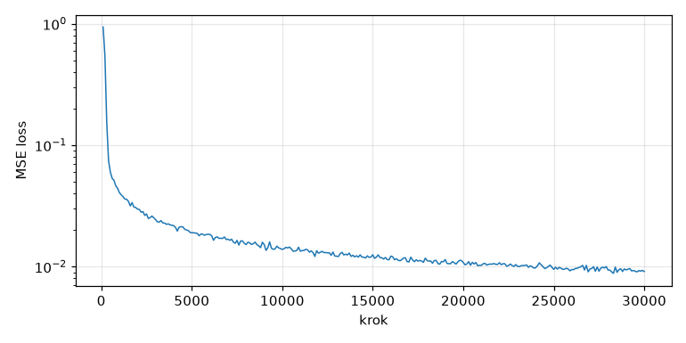
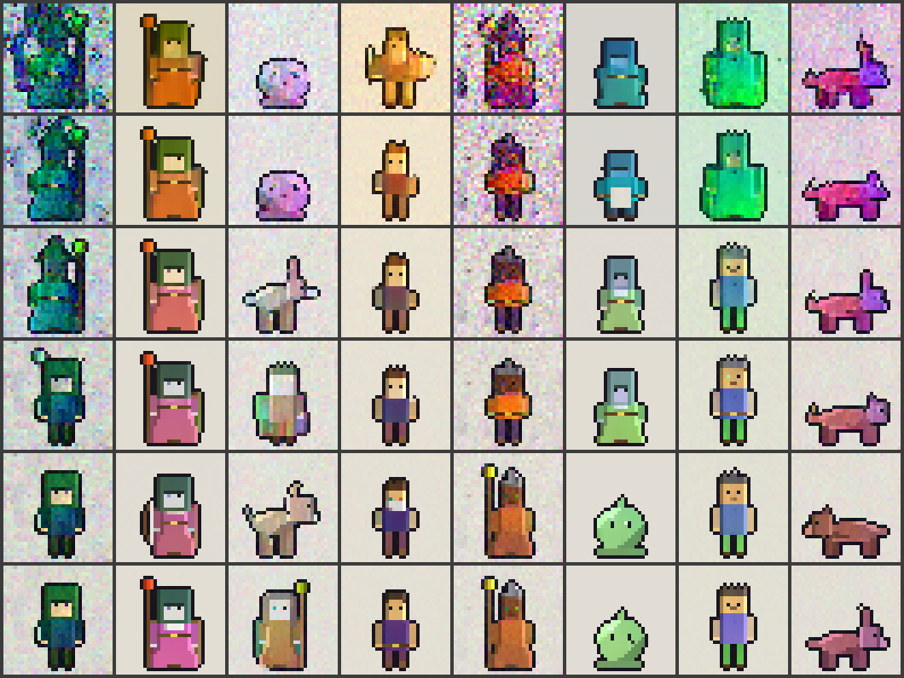
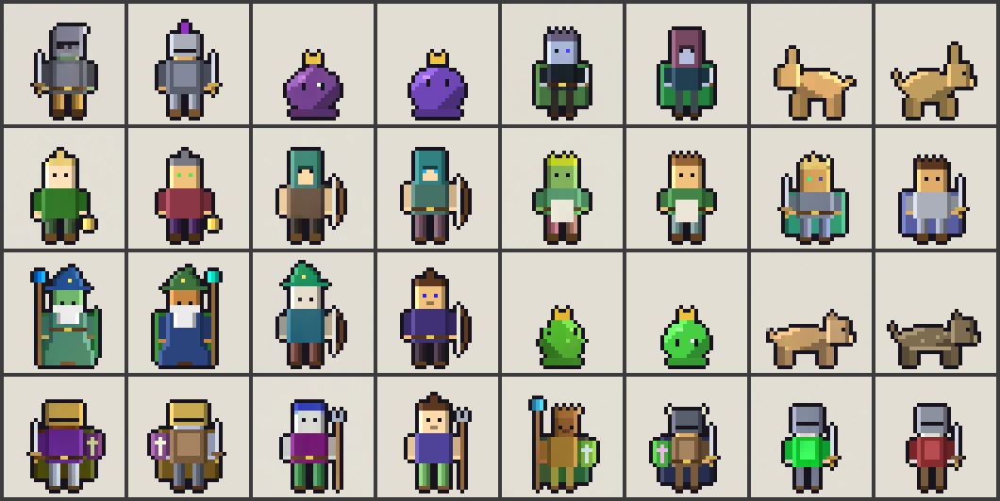
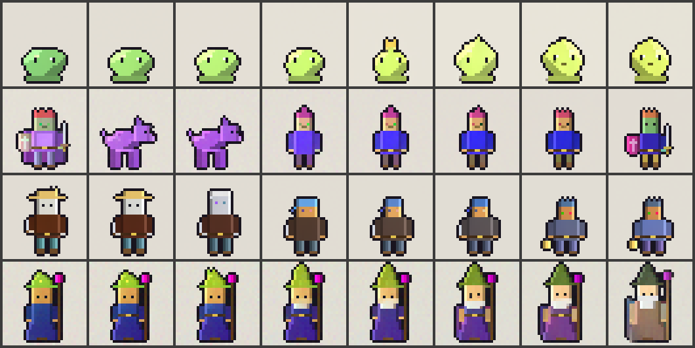

# pixelart-gen

Malý DDPM napsaný od nuly v PyTorchi, natrénovaný na MacBooku Air M2 (8 GB, `mps`).
Generuje nové 32×32 pixel-art postavičky. Bez `diffusers` a bez předtrénovaných modelů.



## Rychlý start

```bash
python3.13 -m venv .venv && .venv/bin/pip install -r requirements.txt
source .venv/bin/activate

python data.py --n 20000                    # dataset -> data/sprites.pt + data/dataset_grid.png
python diffusion.py                         # milník 2: runs/forward_process.png
python unet.py                              # milník 3: kontrola tvarů, počet parametrů, rychlost kroku
python train.py --out runs/overfit --overfit 64 --steps 1500 --sample-every 500   # sanity check
python train.py --out runs/main --steps 30000                                     # hlavní trénink (~8 h)
python sample.py --ckpt runs/main/ema.pt --quantize 12 --nn --interp              # 64 spritů + kontroly
```

Trénink jde přerušit Ctrl+C (uloží checkpoint) a navázat přes `--resume`.

## Soubory

| Soubor | Obsah |
| --- | --- |
| `data.py` | procedurální generátor postaviček, řezání spritesheetů, uložení do `.pt`, `save_grid` |
| `diffusion.py` | kosinový rozvrh, `q_sample`, ε-loss, sampling DDPM a DDIM |
| `unet.py` | U-Net 32→16→8, kanály 64/128/256, ResNet bloky (GroupNorm + SiLU), attention na 8×8 |
| `train.py` | AdamW 2e-4 s warmupem, EMA 0,999, clip gradientu, checkpoint + mřížka vzorků každých 2 000 kroků |
| `sample.py` | generování z EMA vah, kvantizace na paletu (k-means), test kopií (nejbližší soused), interpolace |

## Dataset

Hlavní zdroj je **procedurální generátor** v `data.py`. Licence tím odpadá a dataset má libovolnou velikost.
Šest tříd: rytíř, mág, zloděj, vesničan, sliz, zvíře. Postavy se skládají z dílů (hlava, trup, nohy/róba,
ruce, vlasy nebo pokrývka hlavy, předmět v ruce, štít, plášť), barvy se losují v HSV, každý díl má světlý
levý a tmavý pravý okraj. Nakonec se přidá tmavý obrys a postava se zarovná na střed spodní hrany.
20 000 spritů, všechny unikátní, vygenerované za ~15 s.



Vlastní spritesheety (např. CC0 z OpenGameArt) jdou přidat přes `--sheets data/raw --tile 16`: rozřežou se
na dlaždice, prázdné se zahodí, velikost se změní metodou nearest neighbor a průhlednost se nahradí barvou pozadí.
Licenci každé sady je potřeba ověřit ručně, proto se nic nestahuje automaticky.

Předzpracování odpovídá zadání: pevné pozadí `(226, 222, 212)` místo alfy, uložení jako jeden `uint8`
tensor, normalizace do [-1, 1] při načtení, augmentace jen horizontálním zrcadlením.

## Model a trénink

| | |
| --- | --- |
| Parametry | 15,7 M |
| Difuze | T = 1000, kosinový rozvrh, ε-predikce, MSE |
| Optimalizace | AdamW lr 2e-4 (warmup 500 kroků), batch 64, clip 1,0, EMA 0,999 |
| Trénink | 30 000 kroků (~96 epoch), ~1 s/krok na M2 Air |





## Výsledky

Po 30 000 krocích (8 h 45 min na M2 Air, loss 0,030 → 0,009) model generuje ostré postavičky všech šesti tříd
včetně kombinací dílů, které v datasetu nejsou. **64 spritů přes DDIM s 50 kroky trvá 9,5 s** (DDPM s 1 000 kroky 212 s).

Průběh tréninku na pevném šumu, řádky = krok 2k / 4k / 8k / 14k / 20k / 30k, deterministický DDIM:



Srovnání samplerů na finálním modelu (64 vzorků, stejný seed). „Šum“ je průměrný rozdíl sousedních pixelů,
dataset má 0,164. Kopie = L2 vzdálenost k nejbližšímu spritu v datasetu (včetně zrcadlených) pod 5:

| Sampler | šum | NN medián | NN minimum | kopie | čas |
| --- | --- | --- | --- | --- | --- |
| DDIM 50, `eta=0` | 0,163 | 13,3 | 6,2 | 0/64 | 9,5 s |
| DDIM 50, `eta=1` pro t ≥ 700, pak `eta=0` (výchozí) | 0,168 | 12,8 | 5,3 | 0/64 | 9,4 s |
| DDIM 50, `eta=1` | 0,169 | 12,0 | 4,6 | 2/64 | 9,4 s |
| DDPM 1000 | 0,172 | 11,9 | 6,1 | 0/64 | 212 s |

**Nejde o kopie.** Nejbližší soused vzorku je typicky dál (medián 13) než nejbližší dvojice uvnitř datasetu
(medián 11,5). Vlevo vzorek, vpravo jeho nejbližší soused v datasetu: podobný typ, ale jiná kombinace
barev, pokrývky hlavy a předmětu.



**Interpolace** mezi dvěma šumy (sférická, DDIM `eta=0`, takže deterministická). Většina přechodů je plynulá
(sliz mění tvar a barvu, mág postupně dostává vous). Občas model přeskočí mezi třídami (řádek 2: rytíř → zvíře → vesničan).



**Kvantizace palety.** Jedna společná paleta 32 barev z datasetu (`--palette dataset`) pixely zaostří, ale
posouvá odstíny, protože generátor losuje barvy spojitě v HSV. Paleta zvlášť pro každý sprite
(`--palette sprite`, 12 barev) odstíny drží, jen k-means občas zahodí vzácné barvy, třeba 2px oči slizu.
Výstup modelu je ale ostrý i bez kvantizace.

## Poznatky

**8 GB RAM je hlavní limit, ne výpočet.** Batch 128 nafoukl GPU alokace přes 5 GB, systém začal swapovat
a proces visel ve stavu `U` (čekání na stránkování). Batch 64 drží ~3 GB a jede ~0,8 s/krok (s přiškrcením
na Air kolem 1 s). Zadání říká 64–128; na 8 GB funguje jen spodní hranice.

**Smíšená přesnost nepomohla.** `autocast` s fp16 dal 824 ms/krok, bf16 923 ms, fp32 800 ms. U takhle malého
modelu na MPS nejsou úzkým hrdlem maticové operace.

**První volání na MPS trvá.** Kompilace grafů zabere u prvního forward passu několik sekund. Při měření rychlosti
je potřeba pár kroků zahodit a před stopkami volat `torch.mps.synchronize()`.

**Overfit test na 64 obrázcích prošel, ale ukázal problém v DDIM.** Po 1 500 krocích DDPM (1 000 kroků)
zreprodukoval 55 ze 64 cílů, DDIM s `eta=1` 50 ze 64. Deterministický DDIM (`eta=0`) jen 7 ze 64, zbytek byl
zašuměný, a to i s 1 000 kroky, takže nejde o chybu diskretizace. Rekonstrukce z `q_sample(cíl, t)` fungovala
pro t ≤ 800 (64/64), takže vzorce DDIM jsou správně.

Příčina: kosinový rozvrh končí na ᾱ₉₉₉ ≈ 2,4·10⁻⁹. ε-model musí z `x_t` odhadnout `x_0 = (x_t − √(1−ᾱ)·ε̂) / √ᾱ`,
takže malá chyba ε̂ se zesílí až 2·10⁴×. Ořez na [-1, 1] z toho udělá saturovaný ±1 „šum“ v amplitudě signálu.
DDPM i DDIM s `eta=1` ho v dalším kroku přepíšou čerstvým šumem, kdežto deterministický DDIM ho nese ve složce ε
až do konce. (Viz Lin et al. 2023, *Common Diffusion Noise Schedules and Sample Steps are Flawed*.)

Stejný jev byl vidět i v hlavním tréninku: na kroku 2 000 byla zašuměná zhruba třetina vzorků z `eta=0`,
kdežto `eta=1` dával čisté postavičky. S dalším tréninkem chyba ε̂ v oblasti vysokého šumu klesla a na kroku
30 000 je čistý `eta=0` stejně ostrý jako dataset, jen 2 ze 64 vzorků mají slabý zbytkový šum (viz tabulka výše).
Jde tedy o problém nedotrénovaného modelu, který téměř nulové terminální SNR jen zesiluje.

Oprava bez přetrénování je `churn_above` v `Diffusion.ddim_sample`: pro t ≥ 700 se použije `eta=1`, pak čistý
deterministický DDIM. `sample.py` ji používá jako výchozí pro mřížku (`--churn-above -1` ji vypne), interpolace
jde vždy přes čistý DDIM, protože šum v prvních krocích by `x_T` přepsal. Rozdíl sousedních pixelů
(míra zašumění; dataset = 0,164) u modelu z kroku 2 000:

| Sampler (50 kroků) | rozdíl sousedních pixelů |
| --- | --- |
| DDIM `eta=0` | 0,235 |
| DDIM `eta=0`, hustší kroky u t≈1000 | 0,239 |
| DDIM `eta=0`, ε z modelu místo dopočtu po ořezu | 0,211 |
| DDIM `eta=1` jen pro t ≥ 700 | 0,174 |
| DDIM `eta=1` | 0,160 |

Čistší řešení je v-predikce (`v = √ᾱ·ε − √(1−ᾱ)·x₀`), kde se `x_0` počítá bez dělení √ᾱ. Zadání ale chce
ε-loss, takže zůstala jako rozšíření.

**Kontrola kopií potřebuje referenci.** Procedurální dataset má i mezi různými sprity blízké dvojice
(nejbližší soused uvnitř datasetu: medián 11,5, minimum 2,1 v L2 na [-1, 1]). Overfit model měl medián
4,3, tedy kopie. Vzorky hlavního modelu se proto porovnávají s tímhle rozdělením, ne s nulou.

## Rozšíření

- v-predikce místo ε (viz výše), aby šel použít čistý deterministický DDIM
- podmíněné generování: labely tříd už jsou v `data/sprites.pt`, chybí embedding třídy a classifier-free guidance
- inpainting, export do ONNX / Core ML, 64×64, animační cykly
